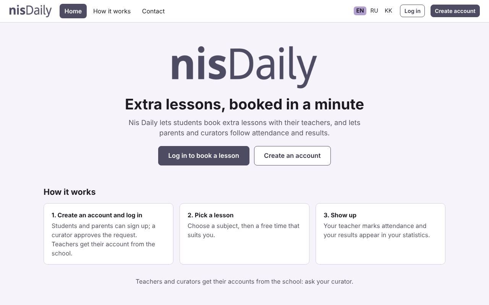
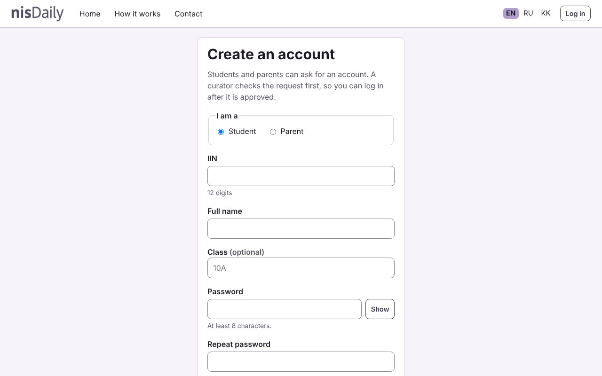
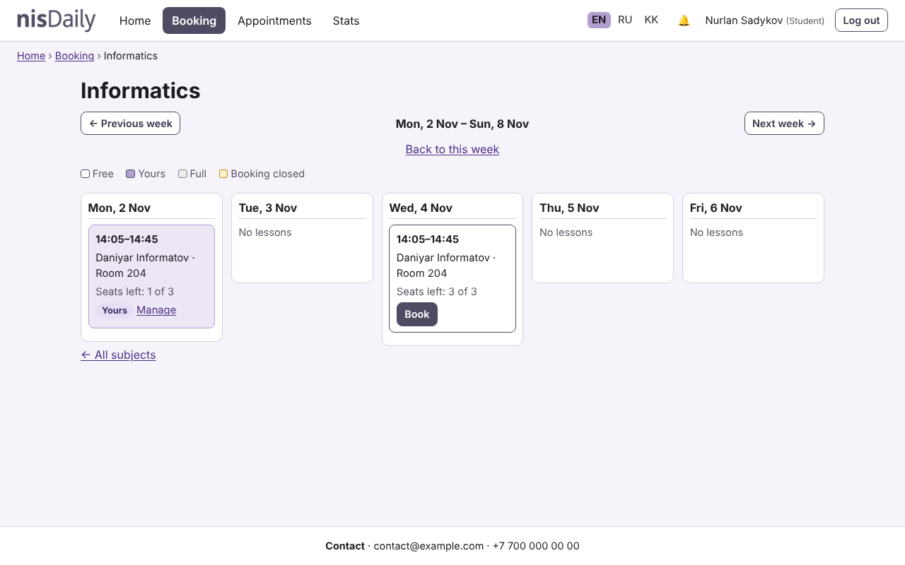
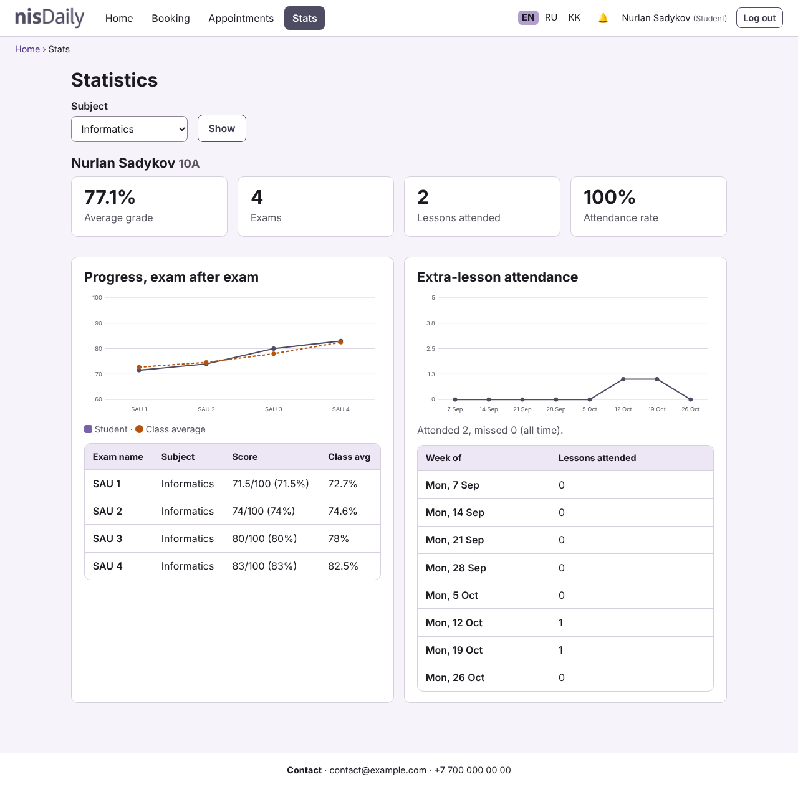
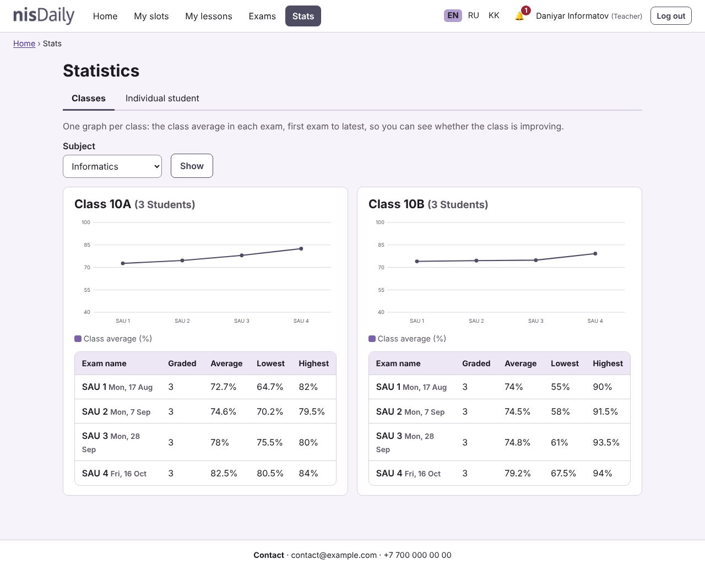
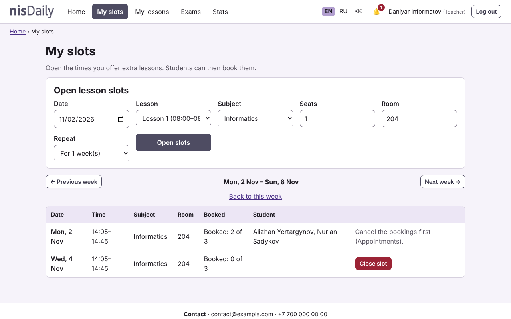
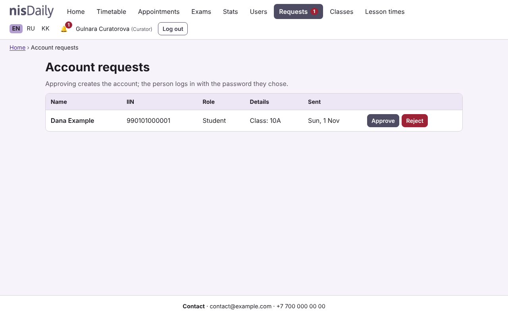
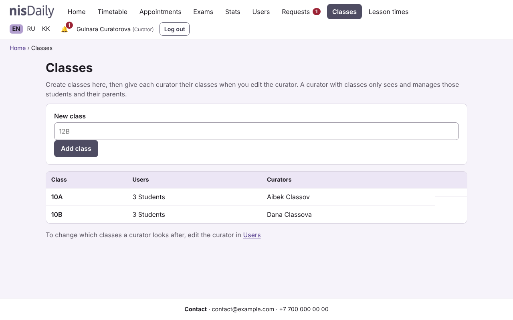
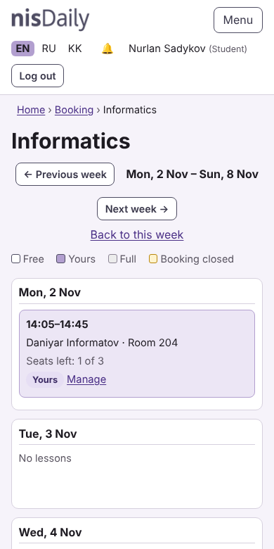
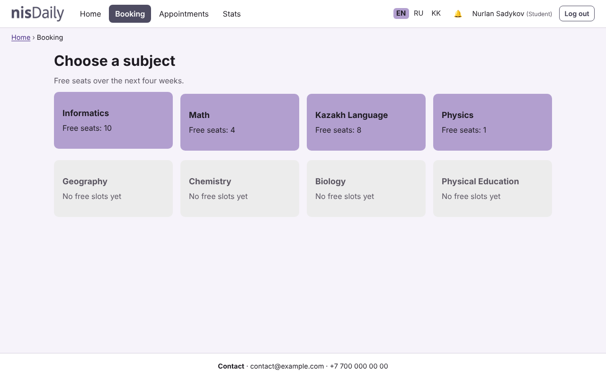

<p align="center"></p>

<p align="center"><strong>Extra-lesson booking for a school.</strong><br>
Students book dated slots with teachers, parents follow results, teachers track each class's progress, curators manage their own classes.</p>

<p align="center">Plain PHP 8.1+ · MySQL · no framework · English / Русский / Қазақша</p>

---

## Contents

- [About](#about)
- [Screenshots](#screenshots)
- [Features](#features)
- [Quick start (XAMPP on Windows)](#quick-start-xampp-on-windows)
- [Configuration](#configuration)
- [Demo accounts](#demo-accounts)
- [Project structure](#project-structure)
- [Database](#database)
- [Security](#security)
- [Tests](#tests)
- [Troubleshooting](#troubleshooting)
- [Limitations and roadmap](#limitations-and-roadmap)
- [License](#license)

## About

Nis Daily started as an early school project: a hard-coded timetable, plain-text passwords and no input handling. This version is a rewrite that keeps the same idea (booking extra lessons at school) and does it properly: real dated slots, a relational database with migrations, role-based permissions, CSRF protection, prepared statements and a test suite.

It deliberately uses **plain PHP without a framework** to show the fundamentals (routing by file, a service layer, templates, a tiny autoloader) rather than hide them.

## Screenshots

| | |
|---|---|
| <br>**Home** (logged out) | <br>**Self-registration** for students and parents |
| <br>**Booking a lesson**: a week view, free seats, one click | <br>**Student progress** against the class average |
| <br>**Teacher: one graph per class**, exam after exam | <br>**Teacher: opening slots** (repeat for several weeks) |
| <br>**Curator: approving account requests** | <br>**Head curator: classes and who looks after them** |
| <br>**Phone layout** | <br>**Subjects** with free seats |

## Features

### Students
- Browse subjects and a week view of free slots; book with one click, cancel before the lesson starts.
- See their own bookings (upcoming / past / cancelled), export them to a calendar (`.ics`).
- Progress graph per subject: their score in each exam against the average of their own class.
- Attendance chart for extra lessons.

### Parents
- Follow each child's bookings, attendance and exam progress (read-only).

### Teachers
- Open lesson slots on the school's bell schedule: choose date, lesson, subject, seats, room, and repeat for several weeks. Close empty slots.
- See who booked, mark **attended / no-show** once the lesson has started.
- Create exams and enter scores (decimals, blanks clear a score).
- **Class progress**: one graph per class for a subject, with the class average in every exam from first to latest, plus a table (graded, average, lowest, highest).
- A teacher only sees a student's results in **their own subjects** and their own extra lessons.

### Curators
- **Head curator** (no classes assigned): sees every class and also manages classes, lesson times and other curators.
- **Class curator** (classes assigned, for example 10A and 12B): sees and manages only those students and their parents: user list, bookings, statistics, exam scores and registration requests.
- Create users (one-time password shown once), import users from CSV, reset passwords, deactivate accounts.
- Approve or reject **account requests** from students and parents.
- The app refuses any change that would leave it without an active head curator.

### Everyone
- Notifications in the app (new bookings, cancellations, registrations), translated into the reader's language.
- English, Russian and Kazakh (Kazakh is a draft: see [limitations](#limitations-and-roadmap)).
- Works on phones, keyboard-friendly (skip link, visible focus, labelled forms), works without JavaScript apart from small conveniences.

### Booking rules (all in `src/Booking.php`)
- No booking of lessons that already started, and a cut-off before the start (default 2 hours).
- No two lessons at the same time for one student.
- At most 3 bookings per subject per week (configurable).
- Seats are limited; the last seat is protected by a database transaction and by `UNIQUE` keys.
- Cancelling keeps the record (history), notifies the other side, and frees the seat.

## Quick start (XAMPP on Windows)

1. Install [XAMPP](https://www.apachefriends.org/) (PHP 8.1 or newer) and start **Apache** and **MySQL** in the control panel.
2. Copy the project so that `C:\xampp\htdocs\nisdaily\index.php` exists (not `htdocs\nisdaily\nisdaily\...`).
3. Create your settings file:
   ```
   cd C:\xampp\htdocs\nisdaily
   Copy-Item .env.example .env
   ```
   The defaults match a fresh XAMPP (user `root`, empty password, database `nisdaily`).
4. Create the tables and load demo data (use the full path if `php` is not on your PATH, or use XAMPP's **Shell** button):
   ```
   C:\xampp\php\php.exe bin\migrate.php
   C:\xampp\php\php.exe bin\seed_demo.php
   ```
5. Open <http://localhost/nisdaily/> and log in with a [demo account](#demo-accounts).

**Without XAMPP**: any PHP 8.1+ with the `pdo_mysql` extension and a MySQL/MariaDB server works. For a quick look: `php -S 127.0.0.1:8080` in the project folder, then open <http://127.0.0.1:8080/>. (The built-in server ignores `.htaccess`, so use Apache or nginx with the private folders blocked for anything beyond a demo.)

To add more demo exams to an existing database (so the progress graphs show a trend): `php bin\add_demo_exams.php`. It is safe to run repeatedly.

## Configuration

Settings come from `.env` (copy `.env.example`). `.env` is ignored by git.

| Variable | Default | Meaning |
|---|---|---|
| `DB_HOST`, `DB_PORT` | `127.0.0.1`, `3306` | MySQL server |
| `DB_NAME` | `nisdaily` | Database name (created by `migrate.php` if missing) |
| `DB_USER`, `DB_PASS` | `root`, *(empty)* | Credentials. Use a dedicated user with a password anywhere but your own PC |
| `APP_DEBUG` | `false` | `true` shows error messages on the error page. Never leave it on in production |
| `APP_TZ` | `Asia/Almaty` | Time zone used for lesson times |
| `BOOKING_CUTOFF_HOURS` | `2` | How long before a lesson booking closes |
| `BOOKING_MAX_PER_SUBJECT_WEEK` | `3` | Bookings one student may hold per subject per week |

## Demo accounts

`bin/seed_demo.php` creates these. **The password for every demo account is `demo12345`.** They are for local testing only: never run the seed on a real database.

| Role | IIN | Notes |
|---|---|---|
| Head curator | `800202300555` | All classes, classes page, lesson times |
| Curator of 10A | `800303300888` | Sees only class 10A |
| Curator of 10B | `800404300999` | Sees only class 10B |
| Teacher (Informatics) | `850101300444` | |
| Teacher (Math, Physics) | `860505300666` | Russian interface |
| Teacher (Kazakh) | `870707300777` | Kazakh interface |
| Students | `030512500111`, `030817600222`, `030301500333` (10A) · `030914600444`, `031122500555`, `030630600666` (10B) | |
| Parents | `780301400333` (one child), `790909400888` (two children) | |
IIN's are FAKE as well as PHONE NUMBERS
You can also create an account yourself on the **Create account** page (students and parents), then approve it as the head curator under **Requests**.

## Project structure

```
index.php, login.php, ...   one file per page (small: read input, call a service, render a template)
bootstrap.php               config, autoloader, session, security headers, error handler
src/                        the logic, one class per concern
  Auth, Policy, Scope       login + rate limiting; every "who may do what" rule; curator class scope
  Booking, Slots, Exams     booking rules, slot management, exams and scores
  Users, Registration       accounts, CSV import, self-registration requests
  Repo, Notify, Chart       queries, notifications, server-side SVG graphs
  Db, Migrator, I18n        PDO wrapper, numbered migrations, translations
templates/                  HTML views (one shared layout)
lang/                       en.php, ru.php, kk.php
migrations/                 numbered SQL files, applied once each
bin/                        migrate.php, seed_demo.php, add_demo_exams.php
tests/run.php               dependency-free test runner
assets/                     stylesheet, small JS, logo
docs/screenshots/           images used in this README
```

Request flow: a page file requires `bootstrap.php`, checks access with `require_login(...)`, calls a service class (which uses `Policy` for permissions), then calls `render()` with a template.

## Database

MySQL/MariaDB. Tables: `users` (login and role) with profile tables `students`, `teachers`, `teacher_subjects`, `parent_student`, plus `classes` and `curator_classes`; `subjects`, `bell_schedule`, `slots`, `appointments`, `exams`, `grades`, `notifications`, `registration_requests`, `login_attempts`.

Design decisions worth knowing:
- **One `users` table for login, separate profile tables per role.** Login and permissions are one code path; role-specific data (class, room, subjects, children) lives where it belongs.
- **Real dated slots** (date + lesson number on a bell schedule) instead of "every Monday", with a `capacity` per slot.
- **Soft cancel**: `appointments.is_active` is `1` for a live booking and `NULL` for a cancelled one. `UNIQUE` keys ignore `NULL`s, so a cancelled seat can be booked again while history is kept.
- **Notifications store a message key plus parameters**, translated when read, so each person sees them in their own language.
- **Migrations** are numbered files recorded in `schema_migrations`; `php bin/migrate.php` applies only what is new.

## Security

- Passwords hashed with `password_hash`; login by IIN with rate limiting (5 failures per IIN and 20 per IP per 15 minutes) and a dummy hash so a missing account takes as long as a wrong password.
- All SQL uses prepared statements. Output is escaped with `e()`.
- CSRF token on every POST (regenerated at login); logout is POST only; session id regenerated at login; session cookie is `HttpOnly`, `SameSite=Lax`, `Secure` on HTTPS.
- Content-Security-Policy with no inline scripts or styles, plus `X-Frame-Options`, `nosniff` and `Referrer-Policy`.
- Redirect targets are validated (no open redirects).
- Every permission rule is in `src/Policy.php` / `src/Scope.php` and covered by tests, including "a class curator cannot touch another class" and "a teacher sees only their own subjects".
- Self-registration creates only a *request*: nothing exists in `users` until a curator approves it. Teachers and curators are never self-registered. Duplicate IINs are ignored silently so the form cannot reveal who is registered; a hidden field and a per-IP limit slow bots.
- `.htaccess` blocks `src/`, `templates/`, `lang/`, `migrations/`, `bin/`, `tests/`, `.env` and `*.sql` on Apache.

## Tests

```
php tests/run.php
```

About 220 checks, no dependencies, using an in-memory SQLite database built from the real migrations (your MySQL data is never touched). They cover permissions, every booking rule, cancel and attendance rules, slots, exams and progress statistics, user management and CSV import, registration, curator scoping, rate limiting, redirects and translation completeness (every key used in code exists, and `ru`/`kk` have exactly the keys of `en`).

## Troubleshooting

| Problem | Fix |
|---|---|
| *Not Found* at `localhost/nisdaily/` | The folder is nested (`htdocs\nisdaily\nisdaily`). Move it so `index.php` sits directly in `htdocs\nisdaily`. |
| `php` is not recognized | Use `C:\xampp\php\php.exe`, or open XAMPP's **Shell**. |
| `Table 'subjects' already exists` when migrating | `DB_NAME` points at an older database. Set a new name in `.env` (for example `nisdaily`) and run `migrate.php` again. |
| A plain "Something went wrong" page | Set `APP_DEBUG=true` in `.env` to see the message (and check Apache's `error.log`). Most often the database is not running or `migrate.php` was not run. |
| Old styles after an update | Hard refresh (Ctrl+F5). Stylesheet links carry a version number, so this should be rare. |
| Seed says "database already has users" | It protects existing data. Use a fresh database, or `add_demo_exams.php` to add exams only. |

## Limitations and roadmap

Honest list of what this is not (yet):
- No waitlist for full slots, and no e-mail or SMS reminders (notifications are in-app only).
- Registration approval is manual; there is no e-mail confirmation.
- Teachers are not tied to specific classes: any teacher can open any student's results, limited to their own subjects.
- The Kazakh and Russian translations are machine-drafted and should be reviewed by a native speaker.
- Not deployed anywhere; a public server needs HTTPS, a dedicated database user, and the web root set so `.env`, `src/` and the other private folders cannot be downloaded.
- Tests are a small custom runner, not PHPUnit; there is no Composer setup.

Ideas for later: waitlist, reminders, teacher-to-class assignment, CSV export of results, a Laravel port.

